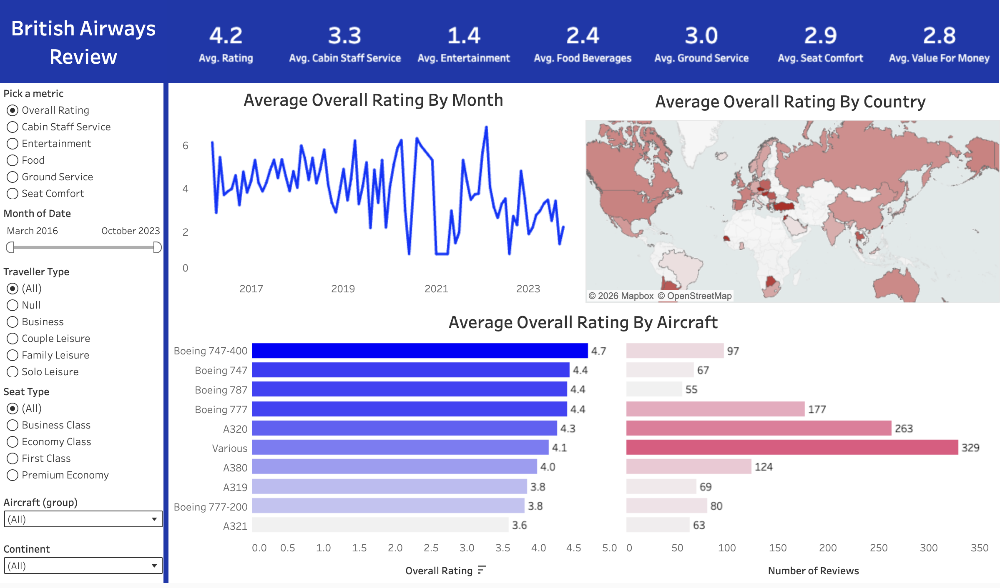

# ✈️ British Airways Review Dashboard (Tableau Project)

## 📌 Project Overview

This project analyzes **1,324 British Airways customer reviews** posted between **March 2016 and October 2023**. I built an interactive Tableau dashboard that shows how passengers rate the airline over time, by country, and by aircraft.

Viewers can pick a service metric, such as seat comfort or food, and filter by date, traveller type, seat class, aircraft, and continent. Every chart updates at once.

🔗 **[View the live dashboard on Tableau Public](https://public.tableau.com/app/profile/omar.shazley)** <!-- EDIT: replace with the direct link to this viz -->

## 🎯 Key Features

✅ KPI banner: average scores for overall rating and six service categories<br>
✅ Metric selector: one parameter switches every chart between seven metrics<br>
✅ Rating trend: average rating by month from 2016 to 2023<br>
✅ Country map: average rating by reviewer country<br>
✅ Aircraft comparison: average rating and number of reviews for each aircraft type<br>
✅ Interactive filters: date range, traveller type, seat type, aircraft, and continent<br>

## 📷 Dashboard Preview



## 🗂️ Repository Files

| File | Description |
|---|---|
| `British_Airways_Review_Tableau.twb` | Tableau workbook with all sheets and the dashboard |
| `ba_reviews.csv` | 1,324 reviews with ratings, aircraft, seat type, traveller type, route, and date |
| `Countries.csv` | Lookup table that maps each country to its continent and region |
| `BritishAirwaysDashboard.png` | Screenshot of the finished dashboard |

## 🧹 Data Preparation

- **Relationship:** linked `ba_reviews.csv` to `Countries.csv` on country name to add a **Continent** field for filtering
- **Aircraft grouping:** the data had 150 different aircraft labels, many with spelling variations. Aircraft with **fewer than 50 reviews** were grouped together so the chart shows only the main types
- **Metric parameter:** created a **"Pick a metric"** parameter and a **CASE** calculated field that returns the chosen rating column
- **Date handling:** set review dates to **Month** level for the trend line and built a range slider filter

```
CASE [Pick a metric]
  WHEN 'Overall Rating'      THEN [rating]
  WHEN 'Cabin Staff Service' THEN [cabin_staff_service]
  WHEN 'Entertainment'       THEN [entertainment]
  WHEN 'Food'                THEN [food_beverages]
  WHEN 'Ground Service'      THEN [ground_service]
  WHEN 'Seat Comfort'        THEN [seat_comfort]
  WHEN 'Value'               THEN [value_for_money]
END
```

## 🛠️ Skills & Tools Applied

- **Tool:** Tableau Public
- **Data modeling:** relationships between two data sources
- **Calculations:** parameters, CASE statements, calculated fields
- **Data cleaning:** grouping inconsistent category labels
- **Visualization:** KPI banner, line chart, filled map, bar charts
- **Dashboard design:** filters, layout containers, consistent color theme

## 📈 Business Questions Answered

This dashboard helps answer the following questions:

- How have customer ratings changed over time?
- Which service areas score the highest and lowest?
- How do ratings differ by reviewer country and continent?
- Which aircraft types get the best and worst ratings?
- How do ratings change by seat class and traveller type?

## 💡 Key Insights

- Overall ratings fell sharply in recent years, from an average of **4.6 (out of 10) in 2017** to **2.6 in 2023**
- **57%** of reviewers said they would **not** recommend British Airways
- **Cabin staff service** scored highest among the service categories at **3.3 out of 5**
- **Food and beverages** scored among the lowest at **2.4 out of 5**
- The **Boeing 747-400** had the highest average rating (**4.7**), and the **A321** had the lowest (**3.6**)
- **Business Class** reviewers gave lower ratings (**3.9**) than Economy (**4.4**) or First Class (**4.4**)
- The **United Kingdom** accounts for **64%** of all reviews (849 of 1,324)

**Data note:** in the raw file, `-1` marks a category the reviewer did not rate. The dashboard's averages count these values, which pulls some scores down. Entertainment is affected most: 457 reviews have `-1`. Without them, entertainment averages **2.7** instead of **1.4**.

## 🚀 Learning Outcomes

📌 Built a parameter-driven dashboard where one control updates every chart<br>
📌 Combined two data sources with a relationship to add new fields<br>
📌 Cleaned messy category labels by grouping low-volume values<br>
📌 Designed a filled map and fit it cleanly inside a dashboard layout<br>
📌 Learned to check raw data for placeholder values that skew averages<br>

## 🙌 Acknowledgment

This project helped me learn parameters, data relationships, and dashboard design in Tableau.

<!-- Optional: add the tutorial name and link here, e.g. "Tutorial by [Name](link)" -->

## 🔗 Related Link

<!-- EDIT: add the LinkedIn post link after publishing -->

## 🧑‍💻 Author

**Omar Shazley**<br>
💼 [LinkedIn](https://www.linkedin.com/in/omar-shazley-914a16b1/)<br>
📧 Email: [omarshazley@gmail.com](mailto:omarshazley@gmail.com)

✨ If you like this project, don't forget to ⭐ star the repo!
